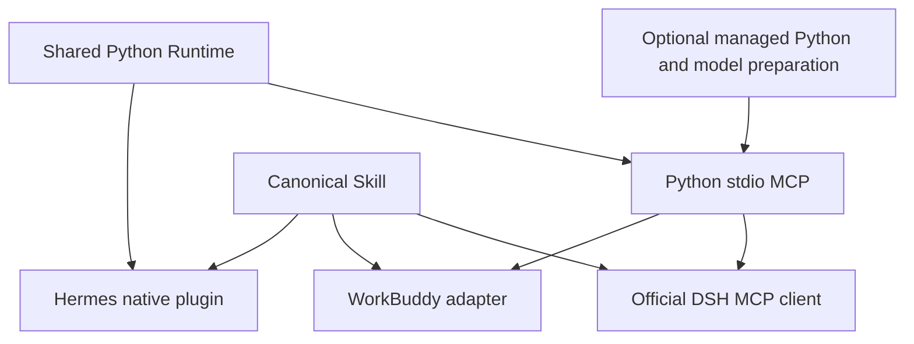

# One memory core, three host integrations

Qdrant Memory uses one Python Runtime for embeddings, Qdrant storage, identity,
scope, WriterLease, ledger and recovery. Hermes uses it through its native
plugin. WorkBuddy and DeepSeek Harness (DSH) use the same four explicit MCP tools.
The [canonical Skill](https://github.com/cnkang/skills/tree/main/qdrant-memory)
provides shared instructions and host-specific references.

The optional Node launcher provisions a private Python environment and verified
CPU embedding model, then forwards requests to the Python server. It does not
implement memory operations or write directly to storage. It shares program
and read-only model files between WorkBuddy and DSH, with separate data profiles.
Its tool catalogue is checked against the Runtime before enabling operations.

See the [Python-versus-Node decision](adr/0001-python-runtime-and-node-launcher.md):
Node improves installation on supported hosts; it does not replace the shared
Python memory engine or require existing Python users to migrate.

WorkBuddy owns its connector metadata, managed Node declaration, connection
timeout and credential form. Its source preview may prepare the backend after
the MCP handshake; tools report preparation errors until ready. Writes are never
queued during installation. DSH uses a separate preparation step, so its
temporary probe, reconnect and plugin unload do not run installers. Its overlay
uses the official MCP client and preserves the host's tool permissions,
cancellation and reconnect policy. Hermes lifecycle remains native.

## Profiles and sharing

| Interface | Default memory location |
| --- | --- |
| Hermes | Existing Hermes profile; unchanged |
| Published standalone MCP | `~/.qdrant-memory`; unchanged |
| DSH Python overlay | `~/.qdrant-memory-dsh` |
| Managed WorkBuddy | `<managed-root>/profiles/workbuddy/local` |
| Managed DSH | `<managed-root>/profiles/dsh/local` |

The managed root is `~/Library/Application Support/qdrant-memory-managed` on
macOS, `%LOCALAPPDATA%/qdrant-memory-managed` on Windows, and
`${XDG_DATA_HOME:-~/.local/share}/qdrant-memory-managed` on Linux.
`QDRANT_MEMORY_MANAGED_ROOT` can select an explicit absolute root for isolated
testing. It never redirects Hermes or the published standalone default.

Cross-host sharing is an explicit operator operation. Do not open an embedded
directory concurrently, even for reads. Local WriterLease protects one profile;
it does not coordinate separate ledgers on different machines. Remote Qdrant
also requires compatible collection identity, scope, embedding fingerprint and
one supported ledger owner. Multi-writer cloud sharing is not certified here.
Never remove locks or change fingerprints to force compatibility.

## Versions and availability

| Component | Pin | Availability |
| --- | --- | --- |
| Published MCP | 0.1.3 | Existing Python/uvx path |
| Published Runtime dependency | 0.2.2 | Existing Hermes/standalone behavior |
| Managed Runtime candidate | `b568e0d5bfe23f10e4b1ea912405c1054730f3b5` | Verified source archive; optional CPU setup |
| Node launcher | 0.1.0 source candidate | Private package; no npm/marketplace release |
| Bootstrap | uv 0.13.1 / Python 3.11.15 | Fixed platform artifacts, verified uv hash |
| Canonical Skill | 0.2.6 | See connector `skill-source.json` for exact commit |
| DSH contract-test packages | 0.2.0-rc.2 | Exact npm test pins and lockfile |

The managed installer verifies its uv executable and Runtime source archive
before execution. uv verifies its managed Python artifacts; Runtime verifies
the CPU model files. Python dependencies and build tools are version and hash
locked; the Runtime is built without an unpinned build environment. Program
directories include the lock digest, so dependency changes cannot silently reuse
another environment. Production release still requires a published Runtime with
setup APIs, native platform gates and marketplace/real-host acceptance.

Publish compatible shared components first, then pin adapters independently.
No existing Hermes user needs to upgrade for these opt-in adapters.

## Native DSH plugin decision

This release defers a native Cordis memory plugin. MCP plus the canonical Skill
already supports explicit durable memory without duplicating the storage engine.
Automatic extraction, prefetch and per-session injection would require separate
user controls and tested Cordis lifecycle integration. They are future work,
not features supplied by this MCP connection. A future plugin must use supported
Runtime interfaces, effect-scoped cleanup and host authorization; it must not
replace AgentLoop or alter Hermes `sync_turn()` / `prefetch()`.
