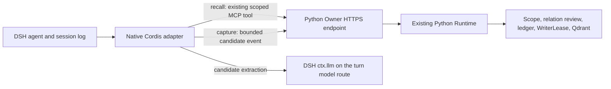

# DSH native memory lifecycle adapter v1

[English](design.md) · [中文](design.zh-CN.md)

## Status and compatibility

This is an opt-in source preview. The native package is private and unpublished.
It targets DSH `0.2.2-rc.1`, Node.js `>=24.9.0`, and Python Runtime 0.6.1 or
newer for versioned candidate events and durable receipt retries. API review used the
official DSH release tag commit
`66491b05e3f05ad35bcdd4f6cd7ed26041d9e3db` and checked the merged source at
`fcc0ad462172522aaf5c93a7b2e01f6b9f0b0159`.

The existing published MCP Bundle and Python/uvx overlay stay on their current
supported route. The native package calls the companion Python Runtime's
versioned `qdrant-memory/extraction-v1` Owner event endpoint; it neither bundles
nor installs the Runtime.
No DSH Core source changes are needed or included.

## Architecture



The adapter is Host-only. It uses DSH's `agent/pre-step`, `session/event`,
`agent/created`, and `agent/disposed` events; `sessions.flush()` is the
durability boundary, and `sessionQuery.readSession()` is the replay-validated
source log. It never reads private `Session.log` state or appends a custom
session event.

The Python process is launched with an absolute interpreter path and the
existing `qdrant_memory.standalone` `remote-call` / `remote-event` commands.
It does not receive unrelated DSH credentials, Qdrant credentials, or any
caller-selected Owner, space, or scope identifier. The Owner derives scope
from the authenticated write grant. No Qdrant client, embedding pipeline,
writer, or second memory ledger is added in TypeScript.

## Default-off configuration

All three switches are explicitly false in the plugin schema and the Bundle
patch:

| Setting | Default | Behavior |
| --- | --- | --- |
| `auto_recall.enabled` | `false` | Enables one scoped search for a direct user message at pre-step |
| `memory_injection.enabled` | `false` | Enables adding the bounded recall result as a logged user message; recall requires this and `auto_recall` |
| `auto_capture.enabled` | `false` | Enables capture of DSH turns ending with `reason.kind === "completed"` |

The Owner URL, token, absolute Runtime Python path, and optional CA file are
environment inputs, not Cordis config values. Automatic capture also requires
an explicitly authorized Owner write grant with a capture rule where policy
requires one. The Owner's existing lifecycle endpoint must be enabled.
Eligible turn content is sent to the provider/model configured for the active
DSH agent so that it can extract candidates; deployments must review that
provider's data policy.

## Recall and injection

Recall runs only when the current `agent/pre-step` payload contains a direct
user message (`source.kind === "user"`). Tool continuations and synthetic
messages do not trigger another search. Credential-shaped input is skipped.
The public `qdrant_memory_search` schema accepts only `query`; the adapter does
not add filters or caller-supplied scope. The Runtime's existing ranking and
result cap remain authoritative.

Retrieved rows are capped at eight by the adapter and the injected JSON is
bounded by `memory_injection.max_chars` (default 3500). Credential-shaped memory
text is omitted. The new user message has source kind `qdrant-memory`, records
the returned IDs and a query hash, and is appended to the current step's
`PreStepDecision.messages`; DSH logs the message before building the model
request. The text is JSON-escaped and explicitly marked as untrusted historical
data. It is never added to the system prompt. Capture ignores this source kind.
Recall failures fail open and do not change the user's request.

## Capture and candidate contract

Only completed turns with at least one direct user text message and one
non-interrupted assistant text message are considered. The adapter ignores
tool calls/results, other injected user messages, `assistant/attempt`, and all
other `turn/end` reasons. It uses the provider/model on the last completed
assistant message. If a replacement candidate is produced, DSH must also return
one exact user-text excerpt of at most 2 KiB; the adapter verifies that it is a
literal substring of the user's text. DSH receives the user and assistant text
for candidate extraction. The Owner event has no assistant field, but its
versioned candidates can contain facts derived from assistant text and are sent
to the Runtime.

The local JSON validator requires the exact `memories` and
`replacement_context` top-level fields and the Runtime's existing four-field
candidate shape. It rejects extra keys, invalid values, secret-shaped text,
oversized results, non-JSON output, and incomplete/max-token responses. The
Owner receives this versioned event:

```json
{
  "event_id": "dsh-native-<sha256>",
  "session_id": "dsh-<sha256>",
  "kind": "turn_completed",
  "candidate_schema": "qdrant-memory/extraction-v1",
  "candidates": [
    {
      "text": "The DSH project uses the existing Runtime.",
      "category": ["project"],
      "importance": 0.8,
      "replacement_intent": false
    }
  ]
}
```

`replacement_context` appears only if at least one candidate has
`replacement_intent: true`. Runtime validates that exact optional field and
uses it only as evidence during its existing relation review. The DSH plugin
does not choose the Owner scope or authorize writes. The four public MCP tool
schemas remain unchanged.

## Idempotence, recovery, and limits

Capture first flushes the DSH session, then reads the full validated event log.
Event IDs are deterministic from the DSH session, turn, and source event
sequences. Before extraction, the adapter checks the Owner receipt. It submits
only on `NOT_FOUND`. A committed or cancelled receipt is not repeated; pending,
failed, or quarantined work is left for Owner recovery rather than re-extracted
under the same ID. The Python client also replays a single candidate body with
the same event ID after an uncertain response.

The queue is bounded to 16 turns and recovery checks at most the latest eight
completed turns when a DSH agent is created. If no durable session flush handler
is registered, capture is skipped. Before DSH flush and an Owner receipt, a
process crash can leave a turn uncaptured. This is a bounded recovery design,
not a zero-loss claim. Queue overflow and owner failures are logged without
transcript content or credentials.

Rollback disables the three switches and removes only the native plugin, then
restarts the selected profile. It does not delete the profile, Owner receipts,
Ledger records, Qdrant collection, or embedding cache. Keep the published
Bundle or Python/uvx overlay as the explicit MCP route during migration.

## Validation boundaries

`integrations/dsh/native/test/native.test.js` uses synthetic session records
and fake host services. It verifies filtering, strict JSON, default-off config,
bounded injection, and cleanup. These unit tests are not live DSH agent
execution, real-model evaluation, Owner connectivity, GUI acceptance, or a
published-package test. The exact DSH CLI and package pins are included in the
lockfile; current CI runs the native unit suite on Linux x64, macOS 15 arm64,
and Windows x64. The legacy published MCP route remains on its separate exact
RC integration lane.
