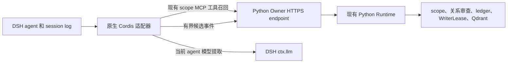

# DSH 原生记忆生命周期适配器 v1

[English](design.md) · [中文](design.zh-CN.md)

## 状态与兼容性

这是可选的源码预览，原生 npm 包为 private 且未发布。目标版本为 DSH `0.2.2-rc.1`、Node.js `>=24.9.0`，并要求 Python Runtime 0.6.1 或更高版本提供版本化候选事件和持久 receipt 重试。接口审查依据官方 DSH 发布 tag commit `66491b05e3f05ad35bcdd4f6cd7ed26041d9e3db`，并核对合并后的源码 commit `fcc0ad462172522aaf5c93a7b2e01f6b9f0b0159`。

已发布的 MCP Bundle 和 Python/uvx overlay 仍使用各自支持路径。Python Runtime 0.6.1 提供本原生包所需的 `qdrant-memory/extraction-v1` 版本化 Owner 候选事件和按 receipt 重试能力。本任务没有修改 DSH Core。

## 架构边界



适配器只负责观察 DSH 生命周期、过滤 turn、调用 DSH 模型抽取候选、把召回结果注入当前决策，以及传输候选。它使用公开的 `agent/pre-step`、`session/event`、`agent/created`、`agent/disposed`、`sessions.flush()` 和 `sessionQuery.readSession()`。不访问私有 `Session.log`，不写自定义 session event。

Python 子进程以 `-I -X utf8` 隔离模式从解释器所在目录启动，项目内容无法遮蔽已安装的 Runtime；同时使用绝对 Python 路径和现有 `qdrant_memory.standalone` `remote-call` / `remote-event` 命令。Owner 根据认证 grant 推导 scope。TypeScript 不增加 Qdrant client、embedding pipeline、writer、ledger 或去重实现；四个公开 MCP 工具 schema 保持不变。

## 默认关闭与配置

插件 schema 和 Bundle patch 明确将三个开关设为 `false`：

| 设置 | 默认值 | 行为 |
| --- | --- | --- |
| `auto_recall.enabled` | `false` | 在 pre-step 对直接用户消息执行一次 scope 内搜索 |
| `memory_injection.enabled` | `false` | 将有界召回结果追加为日志用户消息；召回必须与 auto-recall 同时开启 |
| `auto_capture.enabled` | `false` | 捕获以 `reason.kind === "completed"` 结束的 DSH turn |

Owner URL、token、Runtime Python 路径和可选 CA 文件是进程环境变量，不是 Cordis 配置。捕获还需要已授权 Owner 写入 grant 和相应 capture rule。DSH LLM 会把被选中的 turn 内容发送至当前 agent 配置的模型；部署者应审查该模型供应商的数据政策。

## 召回与注入

仅当 `agent/pre-step` 提供 `source.kind === "user"` 的直接用户文本时，才发起 `qdrant_memory_search`。工具延续和合成消息不触发新搜索。凭证样式的 query 被跳过。调用只传 `query`；不添加过滤器或调用者指定 scope。

适配器最多保留八条记忆，注入 JSON 默认不超过 3,500 字符。凭证样式文本会被过滤。新用户消息带有 `source.kind: "qdrant-memory"`，记录 memory IDs 与 query hash；JSON 文本被标记为不可信历史数据，不进入 system prompt。Capture 忽略该 source kind。Recall 失败时继续普通 DSH 对话。

## 捕获与候选契约

只考虑至少包含一条直接用户文本和一条未中断助手文本、且结束原因为 `completed` 的 turn。忽略工具调用/结果、其他注入用户消息、`assistant/attempt`、其他 turn 结束类型。模型 route 取自最后一条完成的助手消息。替换候选必须引用一段最多 2 KiB 的原始用户文本子串。DSH 会把用户和助手文本交给候选提取模型；Owner event 没有独立的 assistant 字段，但版本化候选可能包含从助手文本提取的事实，并会发送给 Runtime。

本地 JSON validator 要求严格的 `memories` 和 `replacement_context` 顶层字段，以及 Runtime 已有的四字段候选 schema。拒绝未知 key、错误类型、凭证样式数据、过长结果、非法 JSON 和未完成/max-token 输出。Owner event 的核心字段为：

```json
{
  "event_id": "dsh-native-<sha256>",
  "session_id": "dsh-<sha256>",
  "kind": "turn_completed",
  "candidate_schema": "qdrant-memory/extraction-v1",
  "candidates": [{
    "text": "项目使用现有 Runtime。",
    "category": ["project"],
    "importance": 0.8,
    "replacement_intent": false
  }]
}
```

## 幂等、恢复、隐私与限制

捕获先 flush DSH session，再读取经过校验的 event log。事件 ID 由 DSH session、turn 和源事件序列确定。抽取前查询 Owner receipt；只有 `NOT_FOUND` 才会提交。已提交或已取消的事件不再重复；pending、failed、quarantined 工作由 Owner recovery 处理。Python 请求客户端在不确定响应时以同一事件 ID 重试同一候选 body。

队列最多 16 个 turn；agent 创建后最多恢复最近八个完成 turn。无持久化 session flush handler 时不捕获。在 DSH flush 和 Owner receipt 之前崩溃可能留下未捕获轮次；不能承诺零丢失。跨 session private memory 不会自动合并。每个 DSH profile 应使用独立 Owner token。

## 验证范围

`integrations/dsh/native/test/native.test.js` 使用合成 session 和 Runtime 响应，覆盖候选校验、默认关闭、过滤、注入格式、缓存隔离、事件提交和 receipt replay。它不是 DSH AgentLoop 运行、真实模型评估、Owner 联网、桌面 GUI 或已发布 Runtime 验收。精确平台矩阵和本地/CI 证据见[验证报告](validation.zh-CN.md)。
